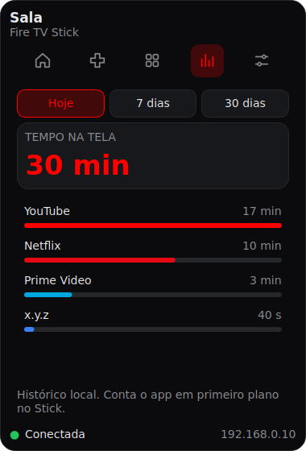
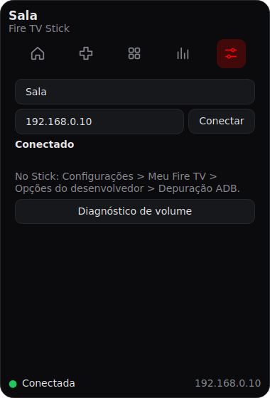

# Fire TV Desktop

**Controle o seu Fire TV Stick pelo PC.** App de bandeja para Windows, feito em Python com PySide6, que fala com o Stick por ADB na rede local: controle remoto, teclado, grade de apps, favoritos e histórico de uso.


> **Projeto pessoal de estudo e prática de programação**, feito para uso próprio e **sem qualquer vínculo com a Amazon**. Veja o [aviso](#aviso).

<p align="center">
  
  
  
</p>
<p align="center">
  
  
</p>

## Por que existe

Este projeto nasceu como **estudo e treinamento prático de programação**. Eu queria praticar Python, interface gráfica (PySide6), comunicação em rede (ADB), testes automatizados e empacotamento, e escolhi um problema real do meu dia a dia: controlar a minha Fire TV pelo computador, sem pegar o controle remoto nem o celular. A ideia é a de um painel na bandeja do Windows, que abre com um clique no ícone.

## Funcionalidades

- **Painel na bandeja do sistema:** abre com um clique no ícone, fecha ao clicar fora, e conecta sozinho ao Stick ao iniciar.
- **Início:** o app em execução na TV, botões de volume e os favoritos. A cor de destaque do painel muda conforme o app (vermelho no YouTube e na Netflix, azul no Prime Video).
- **Controle:** direcional circular, Início, Voltar, Menu, retroceder, play/pause e avançar. Atalhos de teclado (setas, Enter e Esc) que não disparam enquanto você digita.
- **Digitação no PC:** escreva no teclado do computador e envie para o campo de texto aberto na TV.
- **Apps:** apps famosos (Netflix, Prime Video, YouTube, Disney+, HBO Max, Spotify, Apple TV, Paramount+ e outros) e os que você instalou, com busca, favoritos e opção de esconder. Os pacotes do sistema ficam fora da lista, a menos que você peça para ver todos.
- **Atividade:** tempo por app em primeiro plano (hoje, 7 e 30 dias), guardado só no seu PC.
- **Ajustes:** nome da TV, IP do Stick e um diagnóstico de volume que descobre qual comando funciona na sua TV.
- **Reconexão automática** com espera crescente (1, 2 e 4 segundos) se a conexão cair.

## Como usar

### 1. Preparar o Stick (uma vez)

1. No Stick: **Configurações > Meu Fire TV > Opções do desenvolvedor > Depuração ADB** (ligada).
   Se "Opções do desenvolvedor" não aparecer, abra **Sobre** e clique várias vezes em **Fire TV Stick** até ativar.
2. Anote o IP do Stick em **Configurações > Meu Fire TV > Sobre > Rede**. O ideal é reservar um IP fixo para ele no roteador, porque o ADB não se anuncia na rede.
3. Na primeira conexão, a TV mostra um pedido de autorização: aceite e marque "sempre permitir".

### 2. Obter o app

- **Mais fácil (Windows):** instale o Python 3.10 ou mais novo (marque *Add python.exe to PATH*) e dê dois cliques em `build_exe.bat`. Ele cria o ambiente, instala as dependências e gera `dist\FireTVDesktop.exe`, um arquivo único.
- **Sem instalar Python:** no GitHub, abra a aba **Actions**, escolha **Build Windows** e clique em **Run workflow** (ou envie uma tag `v*`). O workflow roda os testes e deixa o `.exe` para baixar como artefato.
- **Pelo código:** veja [Desenvolvimento](#desenvolvimento).

### 3. Conectar

Abra o app. Na primeira vez ele abre em **Ajustes**: digite o IP do Stick e clique em **Conectar**. Nas próximas, ele conecta sozinho.

> **Rede:** o PC e o Stick precisam estar atrás do mesmo roteador. PC no cabo e Stick no wifi funcionam. **Rede de convidados** ou **isolamento de clientes (AP isolation)** costumam bloquear a conexão: se não conectar, confira isso no roteador.

## Limitações conhecidas

- **Volume:** em um Stick, o volume do controle físico usa HDMI-CEC ou infravermelho. Se for infravermelho, o sinal sai do controle e o PC não consegue reproduzi-lo. O diagnóstico em Ajustes testa quatro comandos; se nenhum funcionar, o app esconde os botões. O Stick também não informa o nível de volume.
- **Atividade:** o Stick não informa se a TV está desligada, então o tempo pode incluir períodos com a TV apagada.
- **Nomes de apps:** a tabela de apps famosos usa nomes de pacote do Fire TV levantados em fontes públicas. Um app fora da tabela aparece pelo nome do pacote (veja *Mostrar todos os apps*). Abrir uma issue com o nome do pacote basta para acrescentá-lo.
- **Fora do escopo:** entrada HDMI, ajustes de imagem, espelhamento de tela, botão de ligar e logos oficiais dos apps.

## Arquitetura

Três camadas, com uma regra: a interface nunca fala com o ADB.

```
 interface (PySide6)         painel, abas, componentes, tema
        │  chama
 controle (Python puro)      Controller · Session · apps · activity · volume · config
        │  usa a interface Connection
 conexão (adb-shell)         AdbConnection  ←→  FakeConnection (testes)
```

Decisões que valem destacar:

- **Conexão injetável.** `Connection` é um protocolo; a implementação real usa `adb-shell` e os testes usam uma `FakeConnection`. Nenhum teste usa rede de verdade, e trocar o ADB por outro jeito de falar com o Stick não mexe no resto.
- **Testes primeiro (TDD).** A lógica e a interface têm mais de 290 testes (`pytest` e `pytest-qt`), escritos antes do código. Cada tarefa do projeto virou um commit.
- **Concorrência segura.** Os comandos rodam fora da thread da interface (`QThreadPool`) e passam por um lock na `Session`, porque uma conexão ADB só aceita um comando por vez.
- **Erros que o usuário entende.** Falha de rede, autorização pendente e conexão perdida viram mensagens em português com o que fazer, nunca texto técnico cru.
- **Entradas que não confiam em ninguém.** O nome do pacote é validado antes de entrar num comando de shell, e o texto digitado é escapado; arquivos de configuração e de atividade corrompidos viram `.bak` e o app abre mesmo assim.
- **Dados só no PC.** Configuração, histórico de atividade e a chave ADB ficam em `%APPDATA%\firetv-desktop`.

```
src/firetv/
  connection.py   erros, protocolo Connection, AdbConnection
  session.py      estado da conexão e reconexão
  controller.py   teclas, texto, volume, apps, app em execução
  apps.py         tabela de apps conhecidos, busca, favoritos
  activity.py     registro de atividade
  volume.py       métodos de volume
  config.py       configuração local
  ui/             painel, abas, componentes, tema e ícones
tests/            testes e FakeConnection
docs/planos/      especificação e planos de implementação de cada versão
```

## Desenvolvimento

```bash
python -m venv .venv
.venv\Scripts\activate          # no Linux/macOS: source .venv/bin/activate
pip install -e ".[dev]"
python -m firetv.main           # abre o app
pytest                          # roda os testes
```

Para conferir um executável gerado: `start /wait "" dist\FireTVDesktop.exe --selftest` seguido de `echo %errorlevel%` deve mostrar `0`.

<details>
<summary>Roteiro de teste manual (no Windows, com o Stick real)</summary>

Com o PC no cabo e o Stick no wifi:

- [ ] o ícone aparece na bandeja e o clique abre e fecha o painel
- [ ] o painel aparece perto do relógio e some ao clicar fora
- [ ] ao abrir, conecta sozinho ao IP salvo (na primeira vez, abre em Ajustes)
- [ ] direcionais, OK, Voltar e Início respondem; os atalhos de teclado funcionam e não disparam ao digitar
- [ ] enviar texto simples e texto com acento (o aviso aparece)
- [ ] a grade de apps lista e abre Netflix e YouTube; esconder, mostrar e favoritar funcionam
- [ ] a cor muda ao abrir YouTube e Prime Video
- [ ] Ajustes > Diagnóstico de volume: anotar qual método mexe no volume da TV
- [ ] Atividade passa a somar tempo depois de alguns minutos
- [ ] desligar o Stick e ligar de novo: o rodapé mostra Reconectando e volta
- [ ] fontes e tamanho ficam legíveis no seu monitor

</details>

## Próximos passos

- Conectar a mais de um Stick e trocar entre eles.
- Iniciar junto com o Windows.
- Mostrar o quadro de TV grande na tela Início.
- Publicar o `.exe` como Release no GitHub.

## Aviso

Este é um **projeto pessoal e independente**, criado para **uso próprio** e como **estudo e treinamento prático de programação**. Não é um produto comercial e não é oferecido como serviço. **Não tem qualquer vínculo, patrocínio ou aprovação da Amazon**, nem de nenhuma das marcas citadas.

O app controla o seu próprio aparelho pela depuração ADB, um recurso de desenvolvedor que o próprio Stick oferece, e só em aparelhos e redes que sejam seus. O software é fornecido "como está", sem garantias (veja a licença).

## Licença

[MIT](LICENSE) © 2026 Willian Fournier

