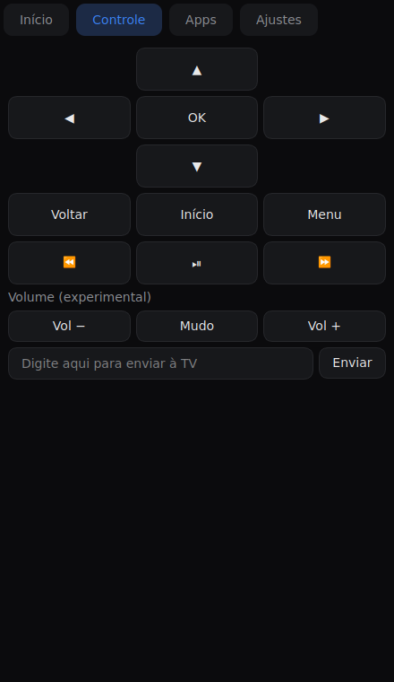
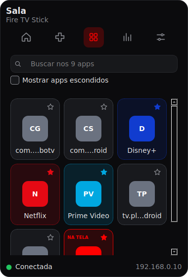
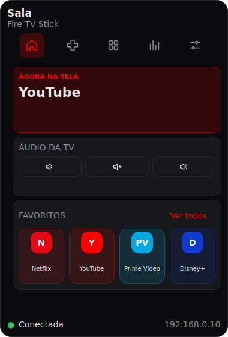
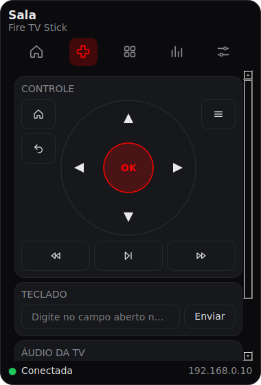

# Fire TV Desktop

Aplicativo de desktop para **Windows** que controla um **Fire TV Stick** pela rede local, via ADB.
Feito em Python (PySide6), com a lógica separada da interface e testada sem precisar da TV.

 

## O que faz

O app vive na **bandeja do sistema** (perto do relógio). Clique no ícone para abrir o painel, e clique fora
para fechá-lo. Para encerrar de verdade, use o botão direito no ícone e escolha **Sair**.
Ao abrir, ele conecta sozinho ao IP salvo.

  

- **Início:** o app em execução na TV, volume e os 4 primeiros favoritos. A cor de destaque do painel muda
  conforme o app (vermelho no YouTube e Netflix, azul no Prime Video).
- **Controle:** direcional circular, Início, Voltar, Menu, mídia e teclado. Atalhos: setas, Enter (OK) e Esc (Voltar),
  que não disparam enquanto você digita em um campo de texto. O Android só aceita ASCII simples ao digitar:
  acentos e `%` são ignorados e o app avisa quais.
- **Apps:** grade dos apps instalados, com busca, favoritos (estrela), opção de esconder/mostrar apps
  (botão direito no app) e o rótulo NA TELA no app que está aberto.
- **Atividade:** tempo por app em primeiro plano no Stick, em Hoje, 7 dias e 30 dias. O histórico é guardado
  só no seu PC (`activity.json`) e começa a contar a partir do primeiro uso. O Stick não informa se a TV está
  desligada, então o tempo pode incluir períodos com a TV apagada.
- **Ajustes:** nome da TV, IP do Stick, conectar e o **Diagnóstico de volume**.

### Volume

Em um Stick, o volume depende de como o controle físico fala com a TV (HDMI-CEC ou infravermelho).
O **Diagnóstico de volume** (em Ajustes) testa 4 jeitos de mandar "volume +" e pergunta qual mexeu na TV;
o app passa a usar o escolhido. Se nenhum funcionar, o volume parece depender do infravermelho do controle
físico, que o PC não consegue reproduzir, e os botões de volume somem.

Fora do escopo: entrada HDMI, ajustes de imagem, transmitir arquivo, cursor da TV, botão de ligar,
logos oficiais dos apps e conexão sem ADB.

## Configurar o Stick (uma vez)

1. No Stick: **Configurações > Meu Fire TV > Opções do desenvolvedor > Depuração ADB** (ligada).
   Se "Opções do desenvolvedor" não aparecer, abra **Sobre** e clique várias vezes em **Fire TV Stick** até ativar.
2. Anote o IP do Stick (**Configurações > Meu Fire TV > Sobre > Rede**).
   O ideal é reservar um IP fixo para ele no roteador, porque o ADB não se anuncia na rede.
3. Na primeira conexão, a TV mostra um pedido de autorização. Aceite (e marque "sempre permitir").

## Rede

O PC e o Stick precisam estar na **mesma rede local**, atrás do mesmo roteador.
PC no cabo e Stick no wifi funcionam. **Rede de convidados** ou **isolamento de clientes (AP isolation)**
costumam bloquear a conexão: se não conectar, confira isso no roteador.

## Instalar e rodar (desenvolvimento)

```bash
python -m venv .venv
.venv\Scripts\activate
pip install -e ".[dev]"
python -m firetv.main
```

## Testes

```bash
pytest
```

Os testes usam uma conexão falsa (`tests/fakes.py`): nenhum teste usa rede de verdade.

## Gerar o executável (Windows)

**Mais fácil:** instale o Python 3.10 ou mais novo (marque "Add python.exe to PATH") e dê dois cliques em
`build_exe.bat`. Ele cria o ambiente, instala as dependências e gera **`dist\FireTVDesktop.exe`**, um arquivo
único que você pode copiar para onde quiser (não precisa instalar nada para abrir).

Para conferir que o executável sobe e que a chave ADB funciona, rode no terminal
`start /wait "" dist\FireTVDesktop.exe --selftest` seguido de `echo %errorlevel%`: deve mostrar `0`.

**Sem instalar Python:** o workflow `.github/workflows/build-windows.yml` gera o `.exe` no GitHub
(aba Actions > Build Windows > Run workflow) e deixa o arquivo para baixar.

Comando manual equivalente: `pyinstaller --noconfirm --onefile --noconsole --name FireTVDesktop --paths src app.py`.

## Arquitetura

Três camadas: **interface** (`firetv/ui`: `panel.py`, abas, componentes e tema), **controle**
(`controller.py`, `session.py`, `apps.py`, `activity.py`, `volume.py`, `config.py`) e **conexão ADB**
(`connection.py`, a única que fala com o Stick). A interface não conhece ADB; trocar a conexão por outra
implementação não mexe no resto. A lógica é testada com uma conexão falsa (`tests/fakes.py`).

## Roteiro de teste manual (no Windows, com o Stick real)

Com o PC no cabo e o Stick no wifi:

- [ ] o ícone aparece na bandeja e o clique abre e fecha o painel
- [ ] o painel aparece perto do relógio e some ao clicar fora
- [ ] ao abrir, conecta sozinho ao IP salvo (na primeira vez, abre em Ajustes)
- [ ] direcionais, OK, Voltar e Início respondem; os atalhos de teclado funcionam e não disparam ao digitar
- [ ] enviar texto simples e texto com acento (o aviso aparece)
- [ ] a grade de apps lista e abre Netflix e YouTube; esconder, mostrar e favoritar funcionam
- [ ] a cor muda ao abrir YouTube e Prime Video
- [ ] Ajustes > Diagnóstico de volume: anotar qual método mexe no volume da TV
- [ ] Atividade passa a somar tempo depois de alguns minutos
- [ ] desligar o Stick e ligar de novo: o rodapé mostra Reconectando e volta
- [ ] fontes e tamanho ficam legíveis no seu monitor

Pontos a conferir no Stick real (os comandos foram escritos sem acesso a um aparelho):
`pm list packages` lista os apps de streaming? Os pacotes da tabela em `apps.py` estão certos?
`dumpsys window | grep mCurrentFocus` devolve o app aberto?

## Licença

MIT.
